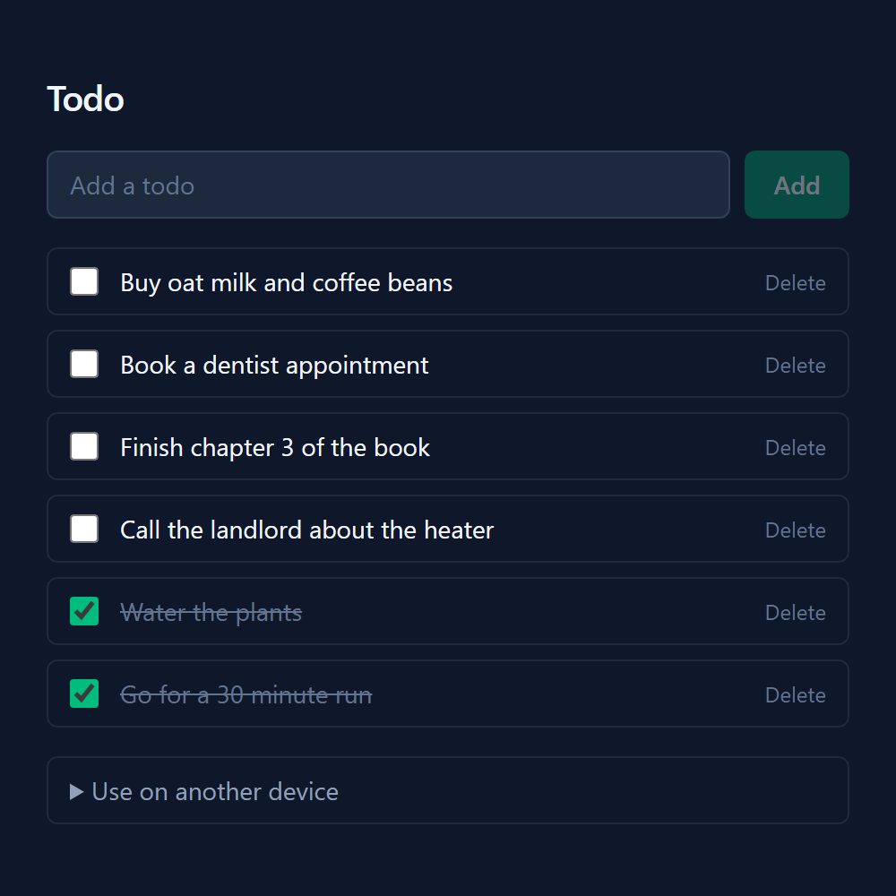

# Todo PWA

A basic todo app learning project, connecting: a Progressive Web App, a REST API and free
hosting fit. Slowly polishing it into something useful.

**[Try it yourself →](https://unun-pwa.netlify.app/)** 
(The backend sleeps when nobody's using it, so first load can take a few seconds.)



## What it does

- Every user gets their own list.
- Your last-loaded list stays readable offline.
- Sync the same list on several devices without making an account (see below).

## How it works

- Install it to your home screen or desktop like a regular app.
```
 Browser / installed app               Render                     Turso
┌───────────────────────┐  fetch  ┌────────────────┐  SQL    ┌──────────────┐
│ web/  React PWA       │ ──────▶ │ api/  Express │ ──────▶ │ todos table  │
│ service worker caches │ ◀────── │ REST API      │ ◀────── │              │
│ the last list offline │  JSON   └────────────────┘         └──────────────┘
└───────────────────────┘
```

## Lists: Private, and Synconizing lists 

The first time you open the app, it creates a random ID for your list and
saves it in the browser. Every request to the API includes that ID, and the API
only returns todos with a matching ID. That is also how every user gets their
own list. "Use on another device" in the app gives you a link containing the ID, 
enabling you to syncronize between devices.
(Make sure to save your ID incase you're not OK with your list being lost!)


## What it's made of

- **Frontend**  (`web/`): React, Vite, Tailwind CSS and vite-plugin-pwa, hosted on Netlify
- **Backend**   (`api/`): Node.js and Express, hosted on Render
- **Database**: SQLite through [Turso](https://turso.tech)
- **Tests**:    Vitest and Node's built-in test runner, run by GitHub Actions on push

Everything runs on free tiers.


## Running it yourself

You need [Node.js](https://nodejs.org) 24 (22.12+ also works). No accounts
needed: locally the API keeps todos in a SQLite file.

```bash
# Terminal 1: the API, on http://localhost:3001
cd api
npm install
cp .env.example .env
npm run dev
```

```bash
# Terminal 2: the app, on http://localhost:5173
cd web
npm install
npm run dev
```

`npm test` runs the tests in either folder. The READMEs in [`api/`](api/README.md)
and [`web/`](web/README.md) have more detail on each half.

<details>
<summary>Deploying your own copy</summary>

1. Create a database on [Turso](https://turso.tech) and note its URL and auth
   token (`turso db show <name> --url`, `turso db tokens create <name>`).
2. On [Render](https://render.com), create a **Blueprint** from this repo; it
   reads `render.yaml`. Fill in `TURSO_DATABASE_URL` and `TURSO_AUTH_TOKEN`, and
   set `CORS_ORIGIN` to `http://localhost:5173` for now.
3. On Netlify or Vercel, import the repo with `web` as the base/root directory,
   and set `VITE_API_URL` to your Render URL.
4. Back on Render, change `CORS_ORIGIN` to your Netlify/Vercel URL.

</details>

## How this was made

Built the first version, polished it with Claude: error handling, list sharing, tests, CI, docs. 
The longer story: [`docs/project-history.md`](docs/project-history.md).

## License

[MIT](LICENSE):  use anything here however you like, if you'd like.
